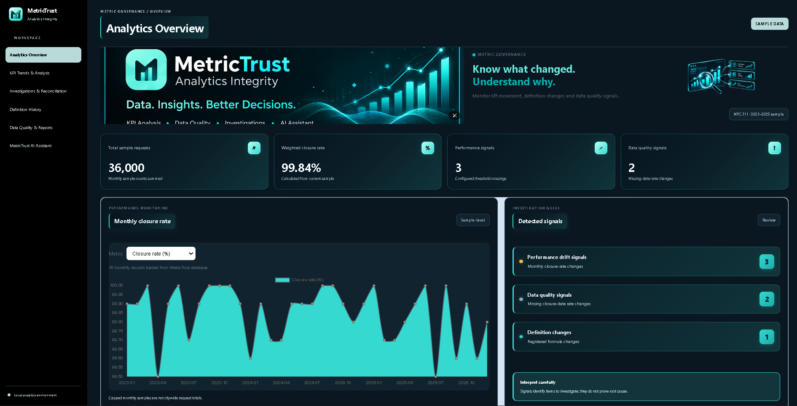

# MetricTrust — KPI Drift & Reconciliation Auditor

<p align="center">
  
</p>

<p align="center">
  <strong>Know what changed. Understand why.</strong>
</p>

MetricTrust is an analytics project designed to investigate KPI movements, monitor data-quality signals, and support metric reconciliation through an interactive dashboard.

Built with Python, Flask, SQL, DuckDB, Pandas, HTML, CSS, JavaScript, and Chart.js.

## Key Features

- **Analytics Overview:** Monitor KPI performance and closure rates.
- **KPI Trends & Analysis:** Explore monthly changes and performance patterns.
- **Investigations & Reconciliation:** Review investigation cases and supporting evidence.
- **Definition History:** Inspect recorded metric definition changes.
- **Data Quality & Reports:** Search, filter, and export monthly data-quality signals.
- **MetricTrust AI Assistant:** Ask questions about closure rates, missing closure dates, and KPI changes using rule-based data analysis.

## Technology Stack

| Technology | Purpose |
|---|---|
| Python | Backend and data processing |
| Flask | Web application and APIs |
| SQL | Data querying and analysis |
| DuckDB | Analytical database |
| Pandas | KPI calculations and transformations |
| HTML & CSS | Dashboard interface |
| JavaScript | Interactive functionality |
| Chart.js | Data visualizations |

## Dataset

This project uses a sample of NYC 311 monthly data. Reported totals and findings refer to the available sample, not official citywide totals.

## Getting Started

### 1. Clone the repository

```bash
git clone https://github.com/saurabhmishra9090/MetricTrust.git
cd MetricTrust
```

### 2. Create a virtual environment

```bash
python -m venv .venv
```

Activate it in Windows PowerShell:

```powershell
.\.venv\Scripts\Activate.ps1
```

### 3. Install dependencies

```bash
python -m pip install -r requirements.txt
```

### 4. Prepare the data

Ensure the required dataset and DuckDB database initialization steps are completed according to the project files.

### 5. Run the application

```bash
python app.py
```

Open `http://127.0.0.1:5000` in your browser.

## KPI Calculation

Closure rate is calculated as:

`Closure Rate (%) = Closed Requests / Total Requests × 100`

Monthly data-quality signals should be investigated against transaction-level records before concluding that a data-quality violation occurred.

## Current Limitations

- Results depend on the available sample data.
- The assistant uses predefined rules and calculations; it is not an LLM-powered chatbot.
- Monthly aggregates do not replace transaction-level reconciliation.

## Author

**Saurabh Mishra**

[GitHub Profile](https://github.com/saurabhmishra9090)

---

*MetricTrust — Analytics Integrity*
